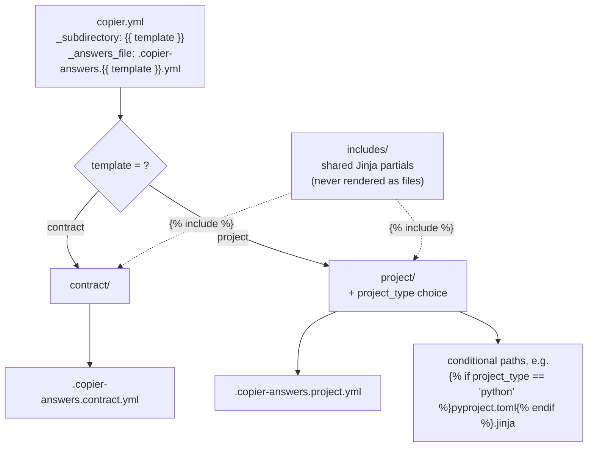
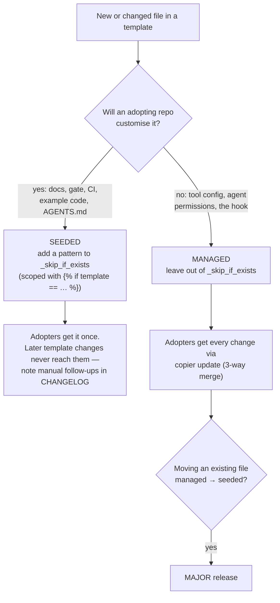
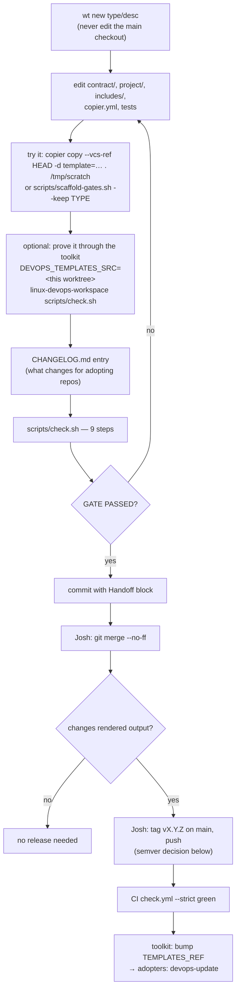
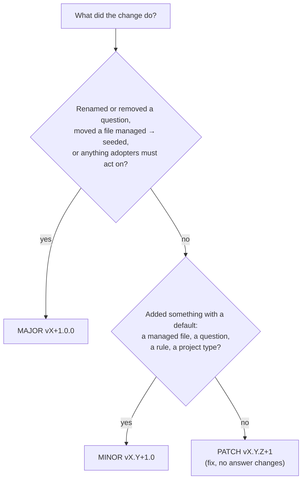
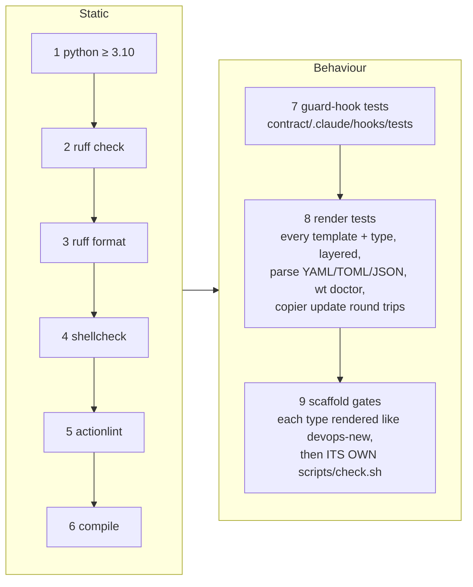
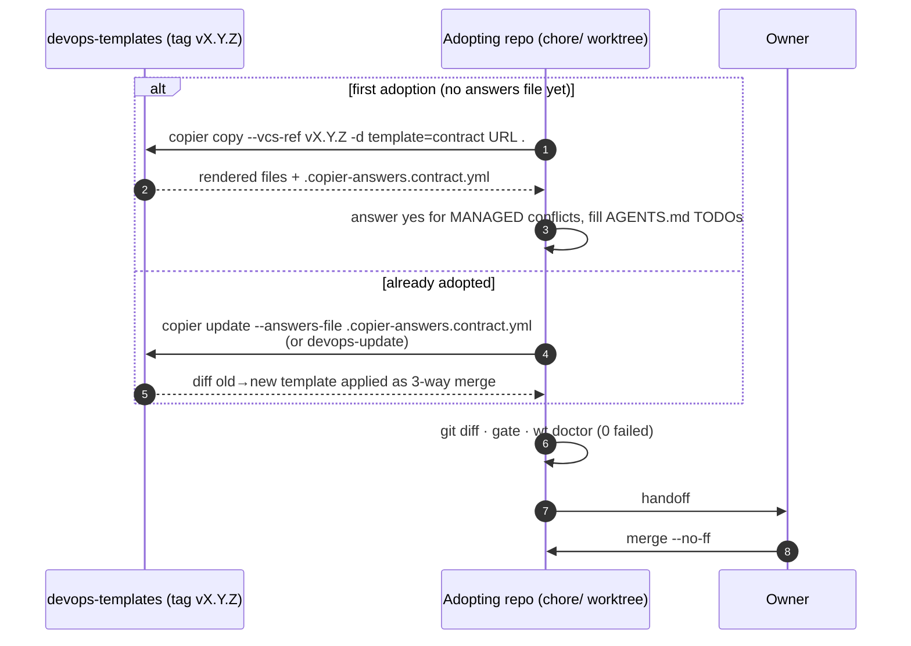

# devops-templates — Operations Guide

**Applies to:** devops-templates v1.1.1
**Audience:** maintainers of the templates (Josh and agents working in this repo), and
anyone operating a repo that has adopted them
**Related:** [README](../README.md) (what each template renders, questions) ·
[multi-agent ready contract](multi-agent-ready-contract.md) · [CHANGELOG](../CHANGELOG.md)

This guide covers how the templates are put together, how a change moves from an
edit to a release, and how adopting repos receive it. The README is the reference
for what the templates render; this is the how-it-runs view.

---

## 1. How the repository renders

One repository, several templates. The `template` answer picks the subdirectory that
Copier renders, and each template writes its own answers file, so templates stack on
one repo without clobbering each other's state.



| Path | What it is |
|---|---|
| `copier.yml` | Questions, `_subdirectory`, `_answers_file`, the seeded list (`_skip_if_exists`), post-copy messages |
| `contract/` | The multi-agent contract layer adopting repos receive |
| `project/` | New-project starter for six types; type-specific files use conditional path names |
| `includes/` | Partials: the shared `AGENTS.md` body, and per-type commands/conventions |
| `docs/multi-agent-ready-contract.md` | The standard (C1–C10) the `contract` layer implements and `wt doctor` checks |
| `tests/` | Render tests (Copier into throwaway repos) |
| `scripts/check.sh`, `scripts/scaffold-gates.sh` | The gate, and the per-type scaffold-and-gate runner |
| Root `.wtconfig`, `.claude/`, `.gemini/` | This repo's **own application** of `contract/` (currently at v1.0.0) — updated with `copier update`, never edited by hand |

---

## 2. Managed vs seeded — the decision that drives everything



Consequence for maintenance: a fix to a **seeded** file (for example a scaffold's
`scripts/check.sh`) only reaches *new* projects. Existing adopters must patch their
copy by hand; the CHANGELOG entry must say so.

---

## 3. Change workflow (edit → release)



### Release level



Tags are PEP 440 `vX.Y.Z` on `main`; there is no version file. Every release that
changes rendered output gets a CHANGELOG entry.

---

## 4. The gate — `scripts/check.sh`

Nine steps, all run, summary at the end. Tool versions are pinned in the script (the
scaffolds' own pins live in `project/scripts/check.sh.jinja`) and run through `uvx`.



| Run | Command | Notes |
|---|---|---|
| Local | `scripts/check.sh` | ~6 min (approximate). Needs bash, git, Python ≥ 3.10, uv |
| Specific Python | `PYTHON=python3.14 scripts/check.sh` | |
| CI | `scripts/check.sh --strict` (Python 3.10 + 3.14) | installs bats, terraform, tflint (Docker on the runner); a SKIP fails; tree must stay clean |
| One type, keep output | `scripts/scaffold-gates.sh --keep python` | prints where the scaffold is |

`wt doctor` checks in step 8 run only where `wt` (devops-workspace) is installed —
mmisadmin02 — not in CI, because the toolkit is a private repo. Run the gate on
mmisadmin02 before release so those checks are exercised.

The CI binary pins (bats, terraform, tflint) must match the ones in
`project/.github/workflows/check.yml.jinja`, so scaffolds and this repo test with the
same tools.

---

## 5. How adopting repos consume a release



Changing an answer without moving versions:

```bash
copier update --answers-file .copier-answers.contract.yml --vcs-ref=:current: -d stale_days=14
```

Never hand-edit managed files or answers files in an adopting repo — the next
update turns that into conflict markers.

---

## 6. Downstream consumer: devops-workspace

The devops-workspace toolkit (`djfiend/linux-devops-workspace`, private) is the main
consumer. It pins one release of this repo (`TEMPLATES_REF`, `v1.1.0` in toolkit
v5.0.0), renders `project` then `contract` through Copier's Python API in
`devops-new`, and updates layers with `devops-update`. Its gate scaffolds every type
from the pinned tag, so **a release here is not used by new projects until the toolkit
bumps its pin and passes its gate**.

What that means when you release here:

| Change here | Also needed in the toolkit |
|---|---|
| Any rendered change | bump `TEMPLATES_REF`, gate, toolkit release |
| New `project_type` | `VALID_TYPES`, `_TYPE_SIGNATURES`, `PROJECT_TYPES`; CI binaries |
| New/changed machine-checkable contract rule | a `wt doctor` check |
| New `wt` command referenced in `.claude/settings.json` | the command must exist in `wt` first |

The full cross-repo picture (context diagram, version matrix, change propagation) is
in the toolkit's `docs/system-integration.md` (private repo).

---

## 7. Routine operations

| When | What | Who |
|---|---|---|
| Every change | worktree → gate → handoff | agent |
| After merge with rendered changes | tag, push, confirm CI green | Josh |
| After a release | open the toolkit pin bump; update this repo's own contract layer if the contract changed | agent proposes, Josh merges |
| Dependabot PR | Action SHA bumps — keep the scaffold CI template pins in step | Josh |
| Periodically | `copier update` this repo's own root (`.copier-answers.contract.yml`) so it dogfoods the latest contract | agent, Josh merges |

---

## 8. Troubleshooting

| Symptom | Cause | Fix |
|---|---|---|
| Rendered file contains `{{` / `{%` | Jinja not applied (missing `.jinja` suffix) or escaped wrongly | render tests catch it; fix the file name or `` |
| Bash `${#arr[@]}` breaks rendering | `{#` opens a Jinja comment | wrap in `…` |
| A project-only seeded path also skips files in `contract` | unscoped `_skip_if_exists` entry | wrap it in `…` |
| Scaffold gate SKIP locally | bats/docker/terraform/tflint missing | fine locally; CI `--strict` runs them |
| `wt doctor` render check skipped | `wt` not installed | install devops-workspace (≥ v4.0.1) |
| Adopter gets conflict markers on update | adopter edited a managed file | move the change here, release, re-update |
| Change didn't reach existing projects | file is seeded | document the manual patch in CHANGELOG |
